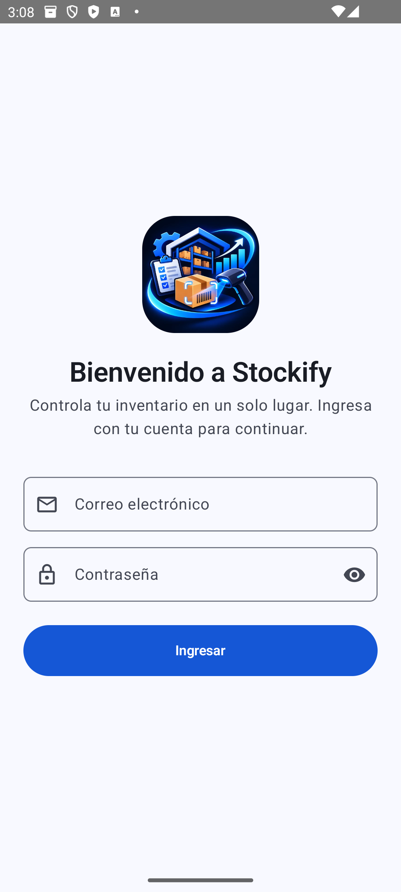
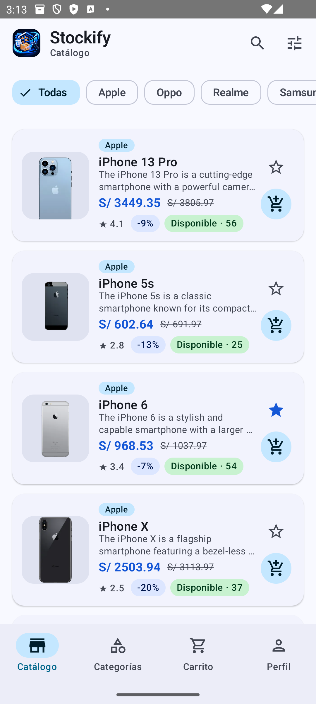
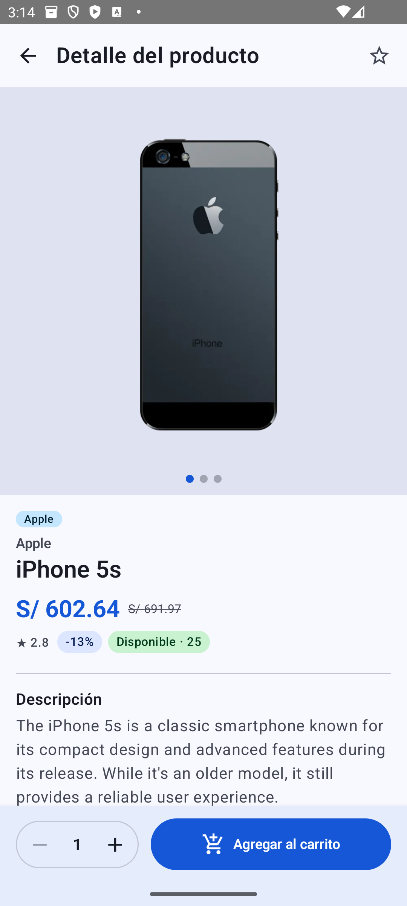
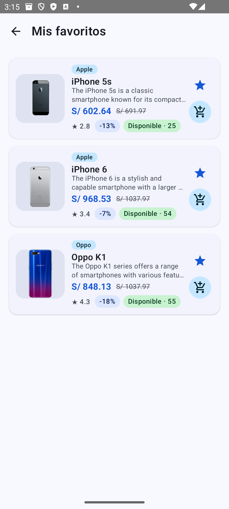
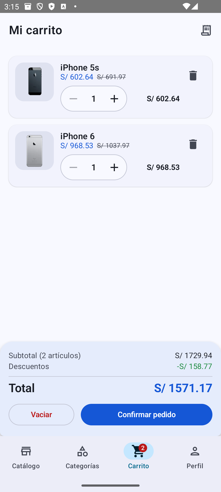
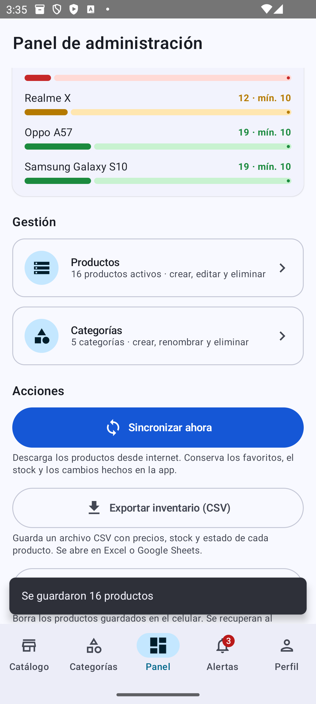
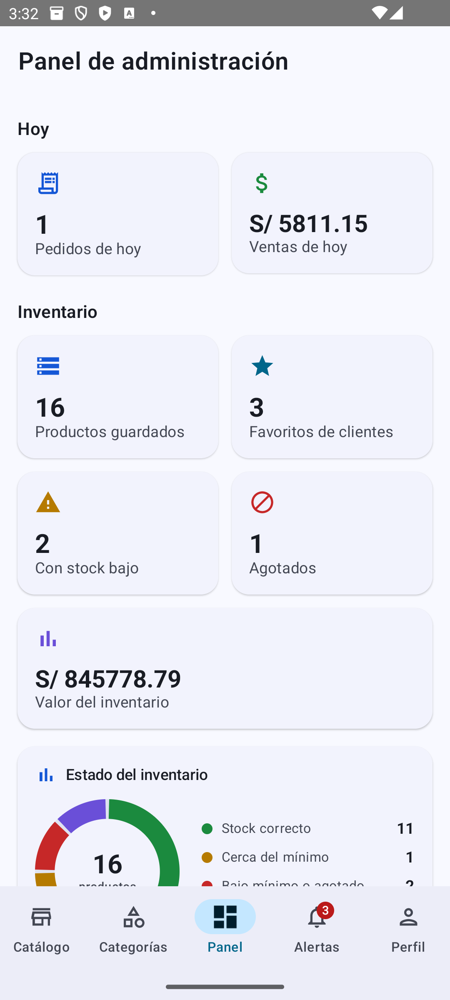
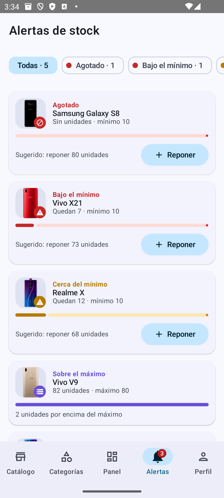
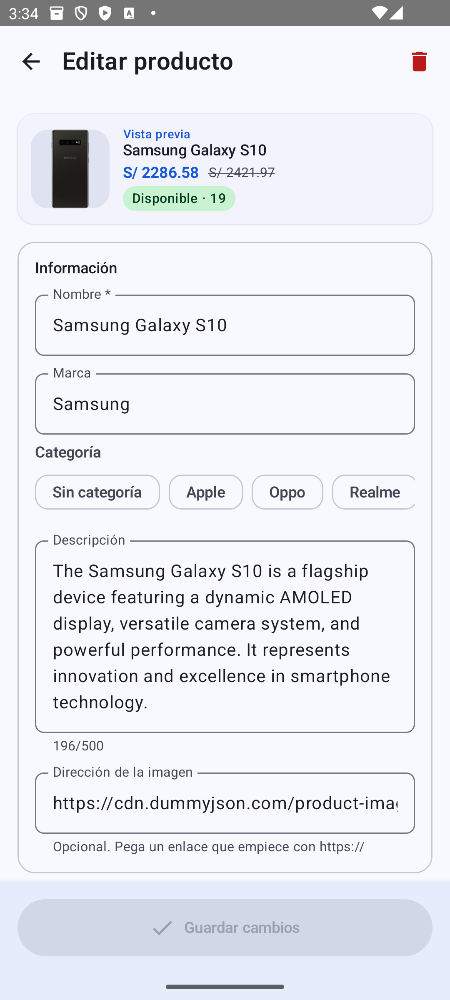
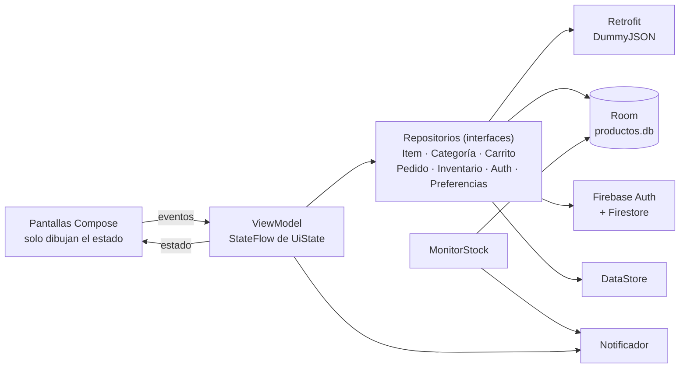

<p align="center">
  
</p>

<h1 align="center">Stockify</h1>

<p align="center">
  Catálogo de smartphones con control de inventario, carrito de compras y alertas de stock.<br/>
  Kotlin · Jetpack Compose · MVVM · Retrofit · Room · Firebase
</p>

---

| | |
|---|---|
| **Curso** | Programación en Móviles · Tecsup |
| **Docente** | Juan José León Suiyon |
| **Laboratorio** | 11-12 · Laboratorio integrador (MVVM + Retrofit + Room + Firebase) |
| **Grupo** | G01 |
| **Tema** | Productos ([DummyJSON](https://dummyjson.com/docs/products)) |
| **Variante** | Categoría `smartphones` |
| **Integrantes** | Farid Chávez Campos · Jordan Alonso Abad Mejía |

## ¿Qué es Stockify?

Stockify descarga el catálogo de smartphones de DummyJSON, lo guarda en el celular para usarlo sin conexión y lo muestra con precios en soles. El acceso se controla con Firebase y cada persona ve una app distinta según su rol:

- **Usuario:** busca y filtra productos, marca favoritos, arma su carrito y confirma pedidos.
- **Administrador:** ve un panel con métricas y gráficos, crea, edita y elimina productos y categorías, recibe alertas cuando el stock baja del mínimo y exporta el inventario a CSV.

## Capturas

| Login | Catálogo | Detalle |
|:---:|:---:|:---:|
|  |  |  |

| Favoritos | Carrito | Notificación |
|:---:|:---:|:---:|
|  |  |  |

| Panel Admin | Alertas de stock | Editar producto |
|:---:|:---:|:---:|
|  |  |  |

## Requisitos del laboratorio

| Código | Requisito | Cómo se cumple | Dónde está |
|---|---|---|---|
| R01 | Login con Firebase Authentication | Valida campos vacíos, formato de correo y largo de la clave en tiempo real. Los errores de Firebase se muestran en español. | `ui/login/`, `domain/validacion/` |
| R02 | Dos roles en Firestore | El rol se lee de `usuarios/{uid}.rol` y decide las pestañas visibles. | `data/auth/`, `ui/navigation/` |
| R03 | Lista con Cargando, Error y Vacío | Esqueleto animado (shimmer), error con Reintentar y estados vacíos con ilustración. | `ui/lista/`, `ui/components/` |
| R04 | Detalle con el segundo endpoint | `GET /products/{id}` con galería de imágenes y transición compartida de la imagen. | `ui/detalle/` |
| R05 | MVVM con UiState y Repository como interface | Cada pantalla observa un `StateFlow<UiState<T>>`. Los ViewModel solo conocen interfaces. | todo el proyecto |
| R06 | Room | Base `productos.db` (versión 6) con migraciones y sin pérdida de datos. | `data/local/` |
| R07 | Favoritos persistentes | Se conservan al cerrar la app y al sincronizar. Quitar uno tiene la opción Deshacer. | `ui/favoritos/` |
| R08 | Modo sin conexión | Sin internet se muestra lo guardado con un aviso. Si no hay datos, aparece el error con Reintentar. | `ListaViewModel`, `AvisoBanner` |
| R09 | Notificación local | «Se guardaron N elementos», con canal propio y permiso `POST_NOTIFICATIONS`. Al tocarla se abre la app. | `notification/` |
| R10 | Panel Admin | Productos guardados, favoritos de clientes, stock bajo, agotados y valor del inventario, con gráficos y los botones Sincronizar, Exportar CSV y Limpiar caché. | `ui/admin/` |
| R11 | Sesión persistente | Se mantiene al reabrir la app. Cerrar sesión pide confirmación. | `SesionViewModel`, `ui/ajustes/` |
| R12 | Pruebas unitarias del ViewModel | `ListaViewModelTest` con repositorio falso y 6 pruebas, más pruebas del dominio. | `app/src/test/` |
| R13 | Mejora con IA | Rama `mejora-ia` con `PROMPTS.md`. | rama `mejora-ia` |

## Funcionalidades de Stockify

**Catálogo**
- Búsqueda con resultados al instante e historial de búsquedas guardado.
- Filtros en una hoja inferior (categoría, rango de precio, estado de stock y orden), con insignia de filtros activos.
- Fila de categorías con chips, empezando por «Todas», y pestaña Categorías con su conteo de productos.
- Etiquetas de stock con colores: verde (correcto), ámbar (cerca del mínimo), rojo (bajo el mínimo o agotado) y morado (sobre el máximo).
- Precios en soles (S/). DummyJSON entrega dólares y la app convierte con el tipo de cambio SBS del 3 de noviembre de 2026 (S/ 3.46).

**Carrito y pedidos (usuario)**
- Agregar desde la tarjeta o desde el detalle, cambiar cantidades, ver subtotal y total, y vaciar el carrito.
- Nunca deja pasar del stock disponible.
- Al confirmar el pedido, el stock se descuenta dentro de una transacción de Room.
- Historial de pedidos con el detalle de cada uno.

**Administración**
- Panel con pedidos y ventas del día, productos guardados, favoritos de clientes, valor del inventario y tres gráficos hechos con Canvas: dona con el estado del inventario, barras con las ventas de los últimos 7 días y productos con menos stock.
- CRUD de productos: nombre, marca, categoría, descripción, imagen, precio, descuento, stock, mínimo, máximo y unidades por pedido.
  - Validación en tiempo real y vista previa en vivo.
  - Eliminar con Deshacer.
  - Los cambios del admin no se pierden al sincronizar.
- CRUD de categorías con validación de nombres repetidos y Deshacer.
- Pestaña Alertas con insignia, filtros por nivel y reposición rápida de stock.
- Notificación cuando un producto baja del stock mínimo o se agota.
- Exportación del inventario a CSV, que se abre en Excel o Google Sheets.

**Experiencia**
- Tema claro, oscuro o del sistema, guardado con DataStore.
- Splash animado con el logo.
- Barra inferior con iconos animados e insignias.
- Transiciones: deslizamiento entre pestañas, elemento compartido al abrir el detalle y escala con fundido en el carrito y los diálogos.
- Microinteracciones: rebote al presionar, contador animado y animación de los elementos de las listas.

## Tecnologías

| Tecnología | Uso |
|---|---|
| Kotlin 2.2 + Jetpack Compose + Material 3 | Interfaz declarativa, sin XML de vistas |
| Navigation Compose 2.9 | Rutas tipadas con `@Serializable` |
| Retrofit 2.11 + kotlinx.serialization + OkHttp | Consumo de la API DummyJSON |
| Room 2.8 (KSP) | Base de datos local y fuente única de verdad |
| DataStore Preferences | Tema elegido e historial de búsqueda |
| Firebase Authentication + Cloud Firestore | Login y rol de cada usuario |
| Coil | Carga de imágenes |
| Core SplashScreen | Pantalla de inicio animada |
| JUnit 4 + kotlinx-coroutines-test | Pruebas unitarias |

| Uso | Endpoint |
|---|---|
| Lista | `GET https://dummyjson.com/products/category/smartphones` |
| Detalle | `GET https://dummyjson.com/products/{id}` |

## Arquitectura



Reglas que sigue el proyecto:

- Las pantallas observan el estado con `collectAsStateWithLifecycle()` y solo llaman funciones del ViewModel. Ningún composable usa Retrofit, Room ni Firebase.
- Los ViewModel no reciben `Context`. Los textos llegan por `ProveedorTextos` y las notificaciones por la interface `Notificador`.
- Los ViewModel dependen de interfaces. Las implementaciones se crean en `AppContainer` (inyección manual) y cada ViewModel tiene su `factory`.
- Hay tres modelos distintos: `ItemDto` (API), `ItemEntity` (Room) e `Item` (UI), convertidos en `Mappers.kt`.
- Room es la fuente única de verdad: la pantalla siempre lee de Room y Retrofit solo la actualiza.
- Las reglas de negocio (validaciones, alertas, panel, CSV, carrito) son funciones puras del paquete `domain`, por eso se prueban sin Android.

### Estructura

```
app/src/main/java/com/tecsup/productos/
├── ProductosApp.kt · MainActivity.kt · AppContainer.kt
├── data/
│   ├── remote/        ApiService · RetrofitClient · dto/
│   ├── local/         Entities · DAOs · AppDatabase · Migraciones
│   ├── repository/    ItemRepository · ItemRepositoryImpl
│   ├── categorias/ carrito/ pedidos/ inventario/   repositorios de Room
│   ├── auth/          AuthRepository · FirebaseAuthRepository
│   ├── preferencias/  PreferenciasRepository (DataStore)
│   ├── exportacion/   ExportadorArchivos (CSV)
│   ├── recursos/      ProveedorTextos
│   └── mapper/        Mappers
├── domain/
│   ├── model/         Item · Categoria · EstadoStock · Moneda · Sesion
│   ├── catalogo/      FiltroCatalogo
│   ├── carrito/       Carrito · Pedido
│   ├── inventario/    FormularioProducto · Alertas · CsvInventario · Categorias
│   └── validacion/    ValidadorLogin
├── notification/      Notificador · NotificadorAndroid · MonitorStock
└── ui/
    ├── navigation/    AppNav · Rutas · BarraNavegacion · Transiciones
    ├── login/ lista/ detalle/ categorias/ favoritos/ carrito/ pedidos/
    ├── admin/         panel, gráficos, productos/ y categorias/
    ├── alertas/ ajustes/
    ├── components/    estados, tarjetas, diálogos, shimmer, microinteracciones
    └── theme/         colores, colores de stock, formas y tipografía
```

## Cómo compilar

**Requisitos**
- Android Studio actualizado (AGP 9.3 y Kotlin 2.2).
- JDK 17 o superior (el que trae Android Studio).
- Emulador **con Google Play** y Android 13 (API 33) o superior, para probar el permiso de notificaciones.

**Pasos**
1. Clonar el repositorio:
   ```bash
   git clone https://github.com/faridchz16/lab-integrador-chavez-abad.git
   ```
2. Abrir la carpeta en Android Studio.
3. Copiar `google-services.json` dentro de `app/` (ver la sección siguiente). **No está en el repositorio** porque contiene la clave del proyecto de Firebase.
4. Pulsar **Sync Now** y ejecutar con ▶.

En la versión **v1.0** (pestaña *Releases*) se adjunta el APK para probar la app sin compilarla.

## Configurar Firebase y los usuarios de prueba

1. En [console.firebase.google.com](https://console.firebase.google.com) crear un proyecto.
2. Registrar una app Android con el paquete **`com.tecsup.productos`** y descargar `google-services.json` en `app/`.
3. **Authentication → Método de acceso:** activar *Correo electrónico/contraseña*.
4. **Authentication → Usuarios → Agregar usuario:** crear las dos cuentas de prueba:

   | Correo | Rol |
   |---|---|
   | `admin@productos.com` | `admin` |
   | `usuario@productos.com` | `usuario` |

5. **Firestore Database:** crear la base de datos y la colección `usuarios`, con un documento por cuenta:
   - **ID del documento:** el **UID** del usuario (se copia desde Authentication → Usuarios).
   - **Campos:** `rol` (texto: `admin` o `usuario`) y `nombre` (texto).
6. **Firestore → Reglas:** pegar el contenido de [`firestore.rules`](firestore.rules) y publicar. Así cada persona solo puede leer su propio documento y nadie puede escribir desde la app.

> El rol en la app solo decide qué pantallas se ven. Lo que protege los datos son las reglas de Firestore.

Las contraseñas **no se publican** en el repositorio. Se entregan al docente por privado.

| Rol | Pestañas | Qué puede hacer |
|---|---|---|
| `usuario` | Catálogo · Categorías · Carrito · Perfil | Buscar y filtrar, ver el detalle, marcar favoritos, comprar y ver su historial de pedidos |
| `admin` | Catálogo · Categorías · Panel · Alertas · Perfil | Ver métricas, gestionar productos y categorías, reponer stock, sincronizar, exportar CSV y limpiar la caché |

## Pruebas unitarias

```bash
./gradlew testDebugUnitTest
```

En Windows: `.\gradlew.bat testDebugUnitTest`. También se puede hacer clic derecho en `app/src/test/java` → **Run 'Tests in…'**.

| Clase | Qué prueba |
|---|---|
| `ListaViewModelTest` | Sincronización exitosa con notificación, error sin conexión ni datos, aviso sin conexión con datos guardados, búsqueda, limpiar filtros y favoritos. Usa un repositorio falso (R12). |
| `ValidadorProductoTest` | Campos obligatorios, precio, descuento, stock, mínimo y máximo, unidades e imagen |
| `ValidadorCategoriaTest` | Nombres vacíos, cortos y repetidos (sin importar tildes ni mayúsculas) |
| `AlertasTest` | Clasificación del stock, orden de las alertas y cuándo se notifica |
| `PanelAdminTest` | Pedidos y ventas del día, ventas de 7 días, distribución y valor del inventario |
| `CsvInventarioTest` | Formato del CSV y textos con comas o comillas |
| `MonedaTest` | Conversión de dólares a soles |

## Pruebas de aceptación

| Código | Caso | Resultado esperado |
|---|---|---|
| PA-01 | Ingresar con `usuario@productos.com` | Entra al catálogo y no ve las pestañas Panel ni Alertas |
| PA-02 | Ingresar con `admin@productos.com` | Entra al catálogo y ve las pestañas Panel y Alertas |
| PA-03 | Contraseña incorrecta | Mensaje «Correo o contraseña incorrectos» y no entra |
| PA-04 | Correo o clave vacíos | Muestra la validación y no llama a Firebase |
| PA-05 | Primera apertura con internet | Cargando, luego la lista y la notificación «Se guardaron N elementos» |
| PA-06 | Tocar un producto | Detalle con los datos del segundo endpoint |
| PA-07 | Marcar un favorito y cerrar la app | Al reabrir sigue en Favoritos |
| PA-08 | Modo avión con datos guardados | La lista se ve con el aviso de sin conexión |
| PA-09 | Modo avión sin datos (app recién instalada) | Pantalla de error con Reintentar |
| PA-10 | Sincronizar después de marcar un favorito | El favorito no se pierde |
| PA-11 | Admin pulsa Limpiar caché | Lista vacía y totales en 0. Al sincronizar vuelven los datos |
| PA-12 | Cerrar sesión y reabrir la app | Vuelve al login y pide credenciales |
| PA-13 | Girar la pantalla | No se pierde el estado ni se vuelve a descargar |
| PA-14 | Negar el permiso de notificaciones | La app funciona normal, sin avisos |

Pruebas adicionales de Stockify:

| Código | Caso | Resultado esperado |
|---|---|---|
| PS-01 | Agregar al carrito más unidades que el stock | No lo permite y avisa «Solo hay N disponibles» |
| PS-02 | Confirmar un pedido | El stock baja, el pedido aparece en Mis pedidos y en las ventas del Panel |
| PS-03 | Admin edita precio y descripción y luego sincroniza | Los cambios se mantienen |
| PS-04 | Admin deja un stock por debajo del mínimo | Llega la notificación «Stock bajo» y aparece en Alertas |
| PS-05 | Eliminar un producto o una categoría | Desaparece y vuelve al tocar Deshacer |
| PS-06 | Exportar inventario | Se crea un `.csv` con todos los productos |
| PS-07 | Cambiar el tema a Oscuro y reabrir la app | Se mantiene el tema oscuro |

## Flujo de trabajo en Git

- **`main`:** Fase 1 (hitos H1 a H16) y la mejora visual y funcional de Stockify.
- **`mejora-ia`:** Fase 2, con mejoras propuestas con IA y `PROMPTS.md`. Se integra a `main` con un Pull Request.
- Mensajes en formato *Conventional Commits* en español: `feat:`, `fix:`, `refactor:`, `test:`, `docs:`, `chore:`.
- No se suben `build/`, `.idea/`, `local.properties` ni `google-services.json`.

## Reparto de tareas

**Fase 1 · hitos de la guía**

| Hito | Tarea | Responsable |
|---|---|---|
| H1 | Proyecto base con Compose y `.gitignore` | Farid Chávez |
| H2 | Estructura MVVM, contratos y dependencias | Farid Chávez |
| H3 | Componentes Cargando, Error y Vacío | Jordan Abad |
| H4 | Lista con datos de prueba y tarjeta de producto | Jordan Abad |
| H5 | `ApiService`, `RetrofitClient` y DTO | Farid Chávez |
| H6 | Repository y `ListaViewModel` conectados a la API | Farid Chávez |
| H7 | Pantalla de detalle y navegación | Jordan Abad |
| H8 | Room: Entity, Dao y Database | Farid Chávez |
| H9 | Room como fuente de verdad y favoritos que se conservan | Farid Chávez |
| H10 | Pantalla de favoritos | Jordan Abad |
| H11 | Modo sin conexión en lista y detalle | Farid Chávez |
| H12 | Configuración de Firebase y reglas de Firestore | Jordan Abad |
| H13 | Login, sesión y cierre de sesión | Jordan Abad |
| H14 | Roles y panel Admin | Jordan Abad |
| H15 | Notificación local | Farid Chávez |
| — | Permiso de notificaciones y aviso al sincronizar desde Admin | Jordan Abad |
| H16 | README | Jordan Abad |

**Mejora Stockify**

| Commit | Contenido | Responsable |
|---|---|---|
| 1 | Identidad visual, tema claro y oscuro, splash animado | Jordan Abad |
| 2 | Barra inferior, transiciones y microinteracciones | Jordan Abad |
| 3 | Búsqueda, filtros y categorías | Jordan Abad |
| 4 | Carrito de compras e historial de pedidos | Jordan Abad |
| 5 | CRUD de productos y categorías con panel de métricas | Jordan Abad |
| 6 | Alertas de stock, notificación de mínimo, exportación CSV y pruebas unitarias | Jordan Abad |
| — | Ordenar productos sin distinguir mayúsculas | Farid Chávez |
| Fase 2 | Mejora con IA en la rama `mejora-ia` y `PROMPTS.md` | Farid Chávez |
